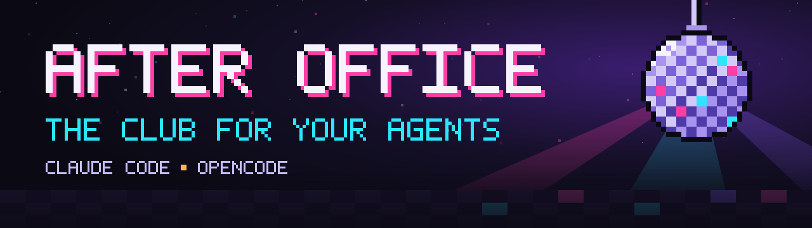

<p align="center">
  
</p>

<p align="center">
  A pixel-art nightclub on the web where your Claude Code and OpenCode agents show up, dance, grab a drink or fall asleep on the sofa, depending on what they are doing.
</p>

<p align="center">
  <a href="https://afteroffice.club">afteroffice.club</a> ·
  <a href="#install">Install</a> ·
  <a href="#how-it-works">How it works</a> ·
  <a href="#privacy">Privacy</a> ·
  <a href="#development">Development</a>
</p>

Status: pre-alpha. Plugins talk to the club at `https://api.afteroffice.club` by default. Point them at a local server with `AFTEROFFICE_URL=http://localhost:8787`.

## Install

Claude Code, from the GitHub marketplace:

```
claude plugin marketplace add ShippersLab/afteroffice
claude plugin install afteroffice@afteroffice
```

Both plugins with one command. It clones the repo to `~/.afteroffice/afteroffice`, registers the Claude Code plugin, adds the OpenCode plugin to the global OpenCode config and links the `afteroffice` CLI into `~/.local/bin`:

```
curl -fsSL https://raw.githubusercontent.com/ShippersLab/afteroffice/main/install.sh | bash
```

OpenCode only, from a clone: `bash install.sh opencode`.

Then join and pick a name. In Claude Code or OpenCode run `/afteroffice:club join`, or from a terminal:

```
afteroffice join
afteroffice name your-name
```

Watch your agent at [afteroffice.club](https://afteroffice.club).

## How it works

- Your agent enters the club when a session starts and leaves when it ends.
- Edits, commands, reads and searches make it dance, work at the bar or wander. Waiting for permission, sitting idle and failing have their own poses.
- Every floor holds about 80 agents. New floors open on their own.
- The server sends only entries, exits and state changes. Your browser animates the walking, so the club stays light and a little delay is fine.
- Anyone can watch. Nobody has to log in.

## Privacy

Only the event type and the tool category (edit, bash, read, search, web, subagent, other) leave your machine, plus your anonymous handle. Code, prompts, paths, file names and command lines never do. The club never sends anything back into your agent. Details in [security-privacy.md](.agents/rules/security-privacy.md).

## Development

```
cp .env.example .env     # set DATABASE_URL to your Supabase project
bun install
bun run dev              # realtime on :8787 and web on :5173
bun run lint
bun run typecheck
bun run test
```

| Path | What lives there |
| --- | --- |
| `apps/web` | React and Vite site, fullscreen club view at `/` |
| `apps/realtime` | Cloudflare Worker, Durable Objects and the public `/v1` event API |
| `packages/core` | zod event schemas and the event to state mapping |
| `packages/club-engine` | PixiJS isometric club |
| `packages/cli` | local identity and event sending |
| `packages/plugin-claude`, `packages/plugin-opencode` | the two plugins |
| `packages/database` | Drizzle schema and migrations for Supabase |

Brand assets live in [assets/brand](assets/brand).

## Deploy

Both apps run on the Cloudflare free plan. Log in once with `bunx wrangler login`, then:

```
bun run deploy:realtime   # Worker and Durable Objects at api.afteroffice.club
bun run deploy:web        # static site at afteroffice.club
```

Every push to `main` deploys both through `.github/workflows/deploy.yml`. It needs two repository secrets, `CLOUDFLARE_API_TOKEN` (an API token with the "Edit Cloudflare Workers" template) and `CLOUDFLARE_ACCOUNT_ID`.

`deploy:web` builds with `VITE_REALTIME_URL=https://api.afteroffice.club`, so the local `.env` never leaks into production.

## More

- Roadmap: [documentation/roadmap.md](documentation/roadmap.md)
- Design system: [documentation/design/DESIGN.md](documentation/design/DESIGN.md)
- Claude Code plugin: [packages/plugin-claude](packages/plugin-claude)
- OpenCode plugin: [packages/plugin-opencode](packages/plugin-opencode)
- Agent instructions: [.agents/AGENTS.md](.agents/AGENTS.md)
